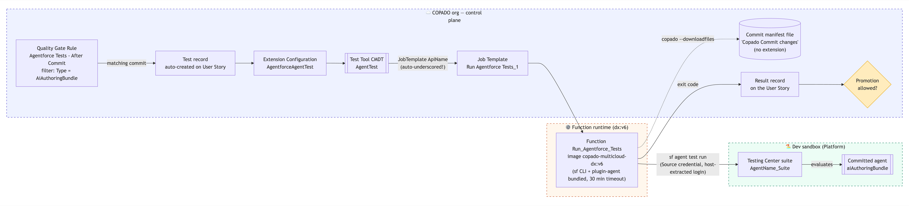
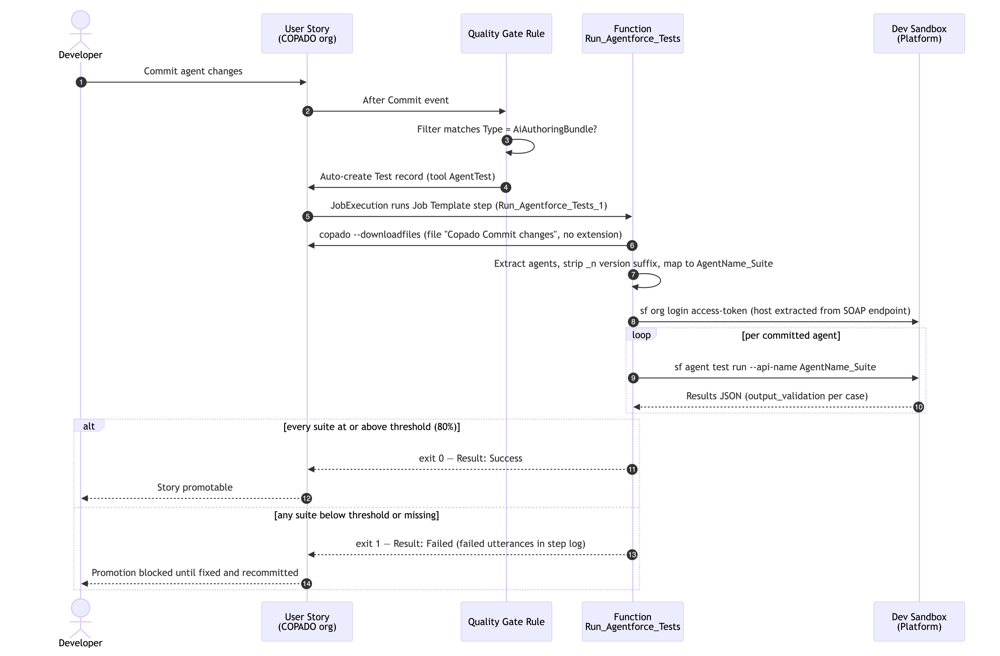

# Agentforce Quality Gate for Copado

A production-proven **Copado quality gate that runs Agentforce Testing Center suites on every agent commit** — suite-agnostic, result-published-to-the-user-story, promotion-blocking. Built on Copado's Quality Integration Framework (Source Format Pipelines) with a custom test tool and a Copado Function.

**First green run:** commit → gate fired → agents detected from the commit manifest → Testing Center suite executed in the dev sandbox → 8/8 cases passed → Result on the user story — in **87 seconds**.

## What it does

1. **Fires on every commit** containing Agentforce metadata (Quality Gate Rule, After Commit, filter `{$Changes.Type.equals("AiAuthoringBundle")}`)
2. **Detects the committed agents** from Copado's commit manifest (`copado --downloadfiles`), normalizes version-suffixed bundle names
3. **Runs each agent's Testing Center suite** (`<AgentApiName>_Suite`) in the story's source sandbox via `sf agent test run` — LLM-judged assertions (`AiEvaluationDefinition`)
4. **Publishes the verdict to the user story** as Test + Result records; a failing (or missing) suite **blocks promotion**

The convention this enforces: *every agent ships with its test suite.*

## Repository layout

| Path | What it is |
|---|---|
| `scripts/run_agentforce_tests.sh` | The gate function (runs in `copado-multicloud-dx:v6`) |
| `scripts/agentforce_deploy.sh` | Companion function: post-deployment publish (`sf agent publish`) + suite gate for promotions |
| `copado/` | Everything registered in the Copado org: Test Tool custom metadata, `copado__Test_Tool` value-set entry, record payloads for Function / Job Template / Quality Gate Rule, rebuild guide (`copado/README.md`) |
| `specs/` | Test suite source (YAML spec → `sf agent test create`) |
| `force-app/main/default/aiEvaluationDefinitions/` | Generated suite metadata — committed with the agent so tests promote version-matched |
| `docs/agentforce-copado-cicd.md` | Full design doc: architecture, sequence and flow diagrams, Copado↔sfdx-hardis mapping, rollback story |
| `.claude/skills/copado-functions/` | A distilled Copado Functions knowledge skill — every platform gotcha that cost a failed run (timeout units, images, CLI surface, dynamic expressions, git auth, manifest format) |
| `lab/artifacts/copado-diagrams.html` | Render source that regenerates all diagram PNGs from the doc's Mermaid |

## The sequence

## Hard-won platform facts (abridged)

- Copado auto-normalizes Job Template API names (spaces → underscores) — point Test Tools at the *real* ApiName
- `copado__Function__c.copado__Timeout__c` is in **minutes**; unset means a ~5-minute kill
- Use the Metadata Image `copado-multicloud-dx:v6` (sf CLI + `@salesforce/plugin-agent` bundled); never npm-install globally inside a function
- `{$Source.Credential.Endpoint}` is a SOAP URL — extract the host before `sf org login access-token`
- The commit manifest downloads as `Copado Commit changes` (no extension), entries `{t, n, a}`, names version-suffixed
- `copado-git-get` needs **both** `git_json` and `provider` parameters

The complete list with fixes lives in [`.claude/skills/copado-functions/SKILL.md`](.claude/skills/copado-functions/SKILL.md).

## Setup in your own org

See [`copado/README.md`](copado/README.md) for the five components and their exact record shapes, and [`docs/agentforce-copado-cicd.md`](docs/agentforce-copado-cicd.md) for the design rationale. Prerequisites: Copado Deployer v24+, Quality Tools v3+, Source Format Pipelines v6+, a published Agentforce agent, and Testing Center enabled in the dev sandbox.
