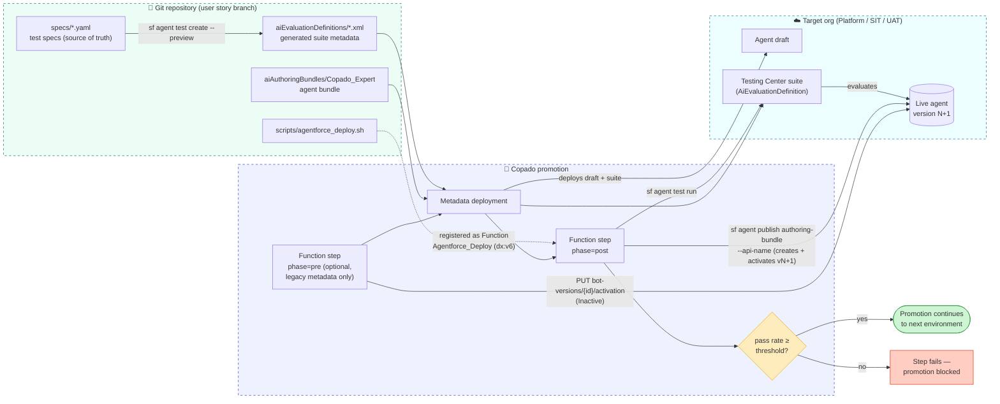
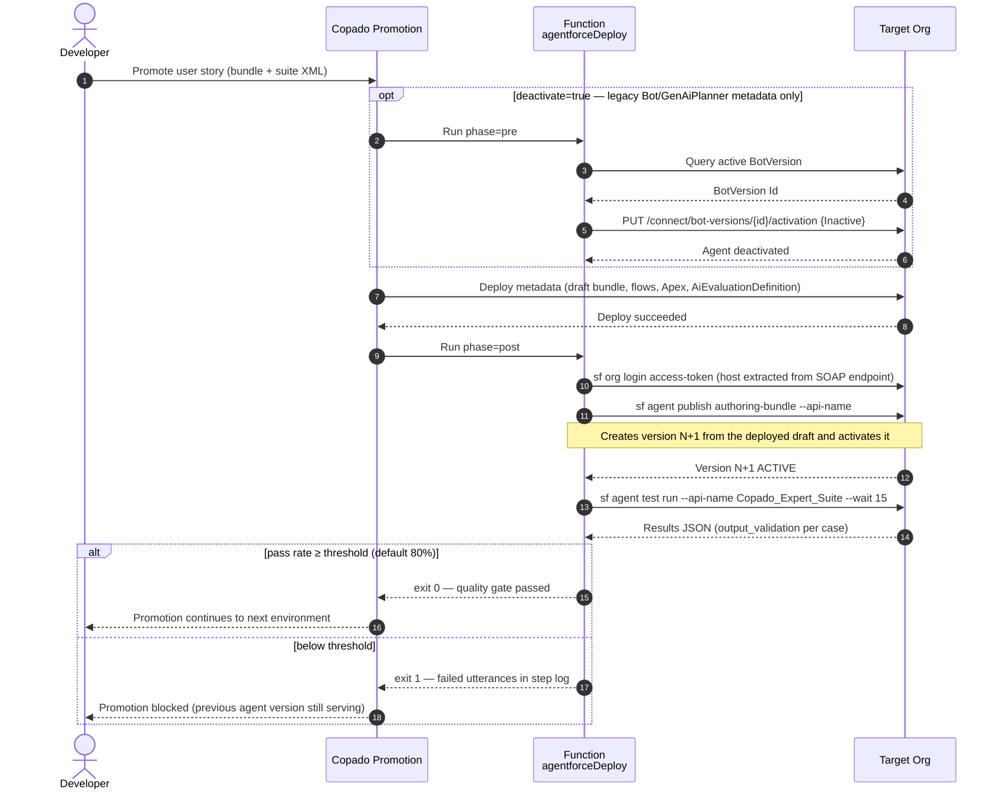
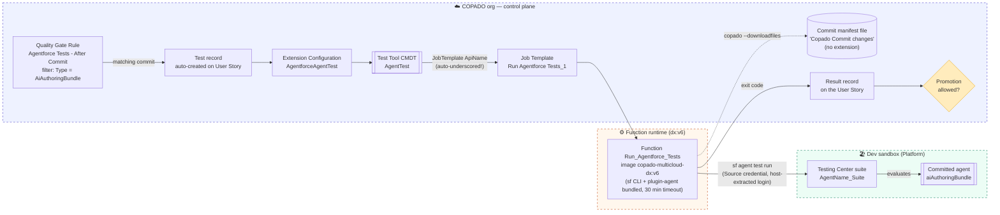
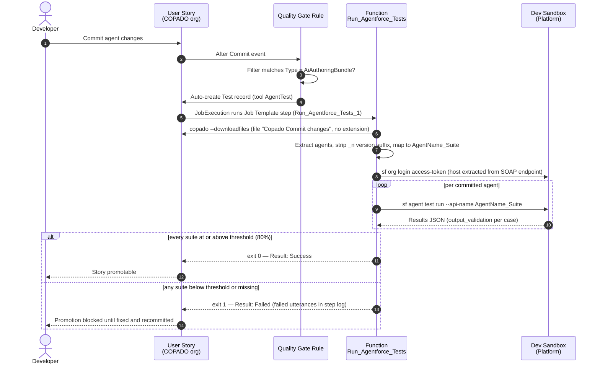
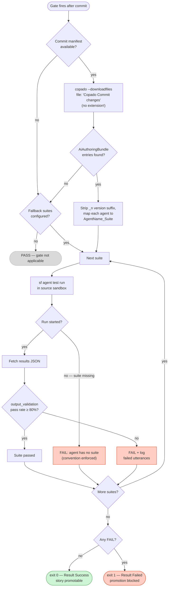

# Agentforce in Copado CI/CD

How to deploy Agentforce agents through the Aldar Copado pipeline with a Copado Function — including the deactivate/deploy/activate nuances and Testing Center suites as a promotion quality gate. Implementation: `scripts/agentforce_deploy.sh` in this repo.

Static PNG exports (for slides / Confluence): [architecture](assets/images/copado-cicd-architecture.png) · [sequence](assets/images/copado-cicd-sequence.png).

## The core insight: which era of agent metadata are you deploying?

The "deactivate → deploy → activate" dance everyone remembers comes from the **legacy** agent metadata model. On API 68.0 the model changed, and the pipeline design follows from it:

| | Legacy (≤ API 67.0) | Current (API 68.0+, this repo) |
|---|---|---|
| Metadata types | `Bot`, `BotVersion`, `GenAiPlannerBundle`, `GenAiPlugin` | `AiAuthoringBundle` (+ `AiAgentDefinition`, `AiAgentDefinitionVersion`) |
| Deploy to an active agent | **Blocked** — must deactivate first | **Allowed** — deploy only updates the *draft* |
| Activation step | Re-activate the BotVersion after deploy | `sf agent publish authoring-bundle` creates **and activates** a new version |
| Version numbers | Promoted with metadata | **Never sync across orgs** — each org numbers its own versions at publish time |

So on the current model the sequence is **deploy (draft) → publish**, not deactivate → deploy → activate. The deactivation path still matters when a promotion carries legacy types or when the target org rejects a deploy against an active agent — so the function supports both.

Reference: the [sfdx-hardis Agentforce CI/CD approach](https://sfdx-hardis.cloudity.com/salesforce-ci-cd-agentforce-agents/), which this design adapts to Copado Functions.

## Three lifecycles ride in one promotion

1. **Metadata** — the `aiAuthoringBundles/<Agent>/` bundle plus its dependencies (flows, Apex, prompt templates, permission sets) and the **test suites** (`AiEvaluationDefinition` is deployable metadata — see below). Copado's normal promotion/deployment handles all of it.
2. **Activation** — publishing the deployed draft as a live version. Copado doesn't do this; the Function's `phase=post` does.
3. **Quality gate** — running the Testing Center suite against the freshly published version and failing the step below a pass-rate threshold. Also `phase=post`.

## Architecture



## The Copado Function

One script, two attachment points, driven by a `phase` parameter (same parameter/env-var conventions as `flow_activation.sh`):

```text
Promotion deployment
├─ [optional] Function step: agentforceDeploy  phase=pre   ← only for legacy metadata
├─ Copado metadata deployment (bundle + flows + apex + AiEvaluationDefinition suites)
└─ Function step: agentforceDeploy  phase=post             ← publish + test gate
```

### Parameters

| Parameter | Example | Notes |
|---|---|---|
| `phase` | `post` | `pre` = deactivate only; `post` = publish + gate |
| `agent_api_name` | `Copado_Expert` | BotDefinition DeveloperName |
| `agent_bundle_name` | `Copado_Expert` | defaults to `agent_api_name` |
| `deactivate` | `true` | pre-phase; default `false` (not needed for API 68 bundles) |
| `publish_mode` | `publish` | `publish` (API 68, default) / `activate` (legacy re-activation) / `none` |
| `test_suite_api_name` | `Copado_Expert_Suite` | run an already-deployed suite (preferred — see below) |
| `test_spec_path` | `specs/copado_expert-testSpec.yaml` | alternative: create suite from YAML (needs `copado-git-get`) |
| `test_pass_threshold` | `80` | % of cases passing `output_validation`; step fails below it |
| `test_wait_minutes` | `15` | test run wait |
| `sessionID` / `endpointID` | *(same dynamic expressions as `flow_activation.sh`)* | Copado org credential |

The function authenticates the `sf` CLI with Copado's own session (`sf org login access-token` using `sessionID`) — no extra credentials, JWT certs, or secrets to manage.

### Promotion sequence



### Registering the function

In Copado: **Functions → New Function**

- API name `agentforceDeploy`, runtime **Bash**
- Image `copado-multicloud-dx:v6`, worker size **M**
- Script body: paste `scripts/agentforce_deploy.sh`
- Parameters: as per the table above (`sessionID`/`endpointID` as the same dynamic expressions used by the flow-activation function)

Scripted/CLI-driven registration is deferred to phase 2.

Use image **`copado-multicloud-dx:v6`** with size **M** — it ships Salesforce CLI 2.152.14 on Node 22.20 with `@salesforce/plugin-agent` 2.2.2 **bundled**, so every `sf agent` command works with zero install time. Do not use `copado-function-core:v1` or the v1 dx image (Salesforce CLI 1.x on Node 18): `sf agent` doesn't exist there, and the current CLI/plugin-agent require Node ≥22 so an in-script `npm install -g` fails too — the script now exits with a clear error on such images instead of installing anything. Then attach it as a deployment step / post-deployment task on the user story or quality gate, exactly like the existing flow-activation function.

## Testing Center suites as part of the deployment

`AiEvaluationDefinition` (what Testing Center calls a test suite) **is metadata**. That makes the clean pattern:

1. **Author** the suite as YAML in `specs/` (source of truth, reviewed like code).
2. **Generate the metadata locally** without touching an org:
   ```bash
   sf agent test create --spec specs/copado_expert-testSpec.yaml \
     --api-name Copado_Expert_Suite --preview
   ```
   `--preview` writes the `aiEvaluationDefinitions/Copado_Expert_Suite.aiEvaluationDefinition-meta.xml` locally. Commit it to the user story **alongside the agent bundle**.
3. **Promote** — Copado deploys the suite with the agent. The test suite now travels through Platform → SIT → UAT with the thing it tests, always version-matched.
4. **Run** — the `phase=post` function runs the suite after publish and gates on the pass rate.

The gate counts `output_validation` (the LLM-as-judge assertion, present on every case because every case sets `expectedOutcome`). This deliberately sidesteps a known Testing Center quirk: guardrail cases without `expectedTopic` report a false-negative `topic_assertion` failure.

**Where to run the gate:** Salesforce advises Testing Center in sandboxes. Run it in Platform/SIT/UAT steps; for PREPROD/PROD promotions leave `test_suite_api_name` empty (publish-only) — the suite already gated the change upstream. Testing Center must be enabled in the target org (Setup → Agentforce Testing Center) and the suite's topic names can drift after republish (re-check on assertion failures).

## Running user (service agents)

`Copado_Expert` is an **employee agent** — it runs as the conversing user, nothing to do. If a **service agent** (`agentType: EinsteinServiceAgent`) enters the pipeline later, its running user must exist in each target org *before* deployment:

- Create it per org: `sf org create agent-user` (profile *Einstein Agent User* + `AgentforceServiceAgent*` permission sets) — the hardis approach.
- The username is embedded in the metadata (`default_agent_user` in the `.agent`, `<botUser>` in `aiAgentDefinition`). Since it differs per org, use **Copado Environment Variables** (find/replace at deployment time) — Copado's native equivalent of hardis `replacementRules` — with a per-environment value like `agentforce.user@aldar.com.sit`.

## Mapping to the sfdx-hardis reference

| sfdx-hardis | This Copado design |
|---|---|
| `sf hardis:project:deploy:smart` | Copado promotion deployment |
| `commandsPostDeploy: agent-publish` action | Function `phase=post`, `publish_mode=publish` |
| `agent-running-user` action + `replacementRules` | `sf org create agent-user` + Copado Environment Variables |
| `runOnlyOnceByOrg: true` | One function step per promotion (Copado step semantics) |
| Branch-scoped config (`.sfdx-hardis.<branch>.yml`) | Per-environment function parameter values on the pipeline step |

## Rollback story

Deploying never touches the live version (draft-only), so a bad change caught by the gate simply never gets published — the previous version keeps serving. If a bad version *was* published: republish the previous commit of the bundle (new version from old code), or deactivate via the function's `pre` phase in an emergency.

---

## Quality gate on every agent commit (feasibility: YES, natively — **BUILT 2026-11-17**)

> **Status:** all five pieces exist in the COPADO org — Function `Run_Agentforce_Tests`, Job Template `Run Agentforce Tests_1`, Test Tool `AgentTest` (+ `copado__Test_Tool` global value set entry), Extension Configuration `AgentforceAgentTest` (active), Quality Gate Rule `Agentforce Tests - After Commit` with its condition (pipeline AldarProperties / env Platform / filter `{$Changes.Type.equals("AiAuthoringBundle")}`) — rule held **Inactive** pending activation.
>
> **Suite-agnostic design:** the function detects committed agents the same way the org's sfdx-scanner QIF function detects changed code — `copado-git-get` clones the repo (via the `git_json = {$Context.Repository.Credential}` parameter), then `git diff` between `DataJson.baseBranch` and `DataJson.featureBranchName` yields the changed `aiAuthoringBundles/<Name>/` paths; it runs `<AgentApiName>_Suite` for each — so one gate covers every current and future agent. (A ContentVersion commit manifest also exists in `DataJson.fileWithSelectedChanges`, but the function CLI has no file-download command, so git is the mechanism.) **Convention (enforced): each agent ships with a Testing Center suite named `<AgentApiName>_Suite` in the dev sandbox; a committed agent without one fails the gate.** Manual test runs without a commit manifest pass trivially (the commit path is the enforcement point).

**The question:** can Copado fire a quality gate on every commit that touches an Agentforce agent, run the Testing Center suite for the committed agents, and publish the result back to the user story? **Answer: yes — this is exactly what Copado's Quality Integration Framework (QIF) does in Source Format Pipelines.** Verified against Copado docs (Deployer v24+, Quality Tools package v3.0+, Copado Source Format Pipelines v6.0+).

### The native chain

```text
Commit on user story
  └─> Quality Gate Rule (action: After Commit)
        └─> Advanced Filter matches committed metadata
            (Property: Type = AiAuthoringBundle — "for Source Format Pipelines, use the metadata type")
              └─> Copado AUTO-CREATES a Test record on the user story
                  (tool = your registered test tool, config = Extension Configuration)
                    └─> Tool's Job Template runs → Copado Function → sf agent test run
                          └─> Result record attached to the Test on the user story (Results tab)
                                └─> FAIL or in-progress ⇒ user story CANNOT be promoted
                                    (Deployer v22.27+ enforcement, override only via
                                     IgnoreTestStatusForPromotion system property)
```

Every requirement in the question maps to a documented feature: *fire on every agent commit* = After Commit action + metadata Type filter; *run the suite for committed agents* = the tool's job template (our function logic with `publish_mode=none`); *publish results to the user story* = automatic Test + Result records ("if you are running the test as part of a quality gate, you do not need to create the test manually — Copado creates and activates the test automatically").

### Architecture

PNG exports: [architecture](assets/images/qgate-architecture.png) · [sequence](assets/images/qgate-sequence.png) · [flow](assets/images/qgate-flow.png)



### Sequence



### Function flow



### What you build (4 pieces, 3 are clicks)

1. **Test Tool registration** — a *Test Tool* custom metadata record (Setup → Custom Metadata Types → Test Tool → Manage) naming "Agentforce Testing Center" and pointing at the job template below. This is the "build your own quality tool" path the docs explicitly allow.
2. **Job Template** — one Function step calling `agentforce_deploy.sh` with `phase=post`, `publish_mode=none`, `test_suite_api_name=<convention>`; the suite runs against the user story's **source org credential** (the dev sandbox where the committed agent lives — Testing Center is sandbox-only anyway). Suite-name convention: `<AgentApiName>_Suite`, with the committed agent names readable from the user story's committed metadata (`copado__User_Story_Metadata__c` records of type `AiAuthoringBundle`).
3. **Extension Configuration** record — tool + test type, active; holds default acceptance criteria (the pass-rate threshold).
4. **Quality Gate Rule** — Quality Gate Rule tab → New: pipeline, tool, run option **After Commit**, scope (stages recommended), Advanced Filter `Type equals AiAuthoringBundle` (add `OR` rows for `Bot` / `GenAiPlannerBundle` if legacy types ever appear; one value per filter row).

Considerations from the docs worth designing around: gates don't run on back-promotions; Before/After Promotion gates can be excluded from validation promotions via the Test Tool metadata (`Exclude from Validation Promotion`); and the promotion block is absolute while tests are failed/in-progress unless the `IgnoreTestStatusForPromotion` system property is set (not recommended).

### Copado QIF vs GitHub Actions on Pull Request

| | **Copado QIF gate (recommended)** | **GitHub Actions on PR** |
|---|---|---|
| Trigger granularity | Every commit on the user story, filtered to agent metadata | Every PR (or push) touching `force-app/**/aiAuthoringBundles/**` |
| Results visibility | **On the user story** (Tests/Results tab) — release managers and CAB see it where they work | In GitHub checks — invisible from Copado unless someone clicks through |
| Enforcement | **Blocks promotion natively** until green | Blocks PR merge; Copado promotion unaware unless you also wire a PR-type gate |
| Setup effort | Test Tool + Job Template + Ext. Config + Gate Rule (one-time, ~half day) | One workflow file (an hour) — but needs its own org auth secrets per sandbox |
| Auth | Copado's own org credentials — zero new secrets | `SFDX_AUTH_URL` secrets to create, rotate, and audit per org |
| Scalability | New agents picked up automatically by the Type filter; per-story tests scale with the pipeline | Scales fine technically, but feedback stays per-branch, not per-story |
| User-friendliness for Aldar | One pane of glass; matches how the team already works (user stories, promotions, CAB) | Developer-friendly, admin-invisible |

**Recommendation:** build the Copado QIF gate — it's the only option that satisfies "publishes the result back to the Copado user story" natively and blocks promotion without glue code. Keep the GitHub Actions workflow (lab Module 5) as the fast pre-commit feedback loop on feature branches if desired; they're complementary, not competing. If the Quality Tools package or permissions (`Configure AQF` / `Access AQF`) turn out to be unavailable in the Aldar org, the fallback is the same function attached as an **After Commit automation / commit-triggered job step** — same script, same result, minus the native Test-record UX.

**Sources:** [Configure a Quality Gate](https://docs.copado.com/articles/#!copado-pipelines-publication/configure-a-quality-gate) · [Create and Configure Test Records](https://docs.copado.com/articles/#!copado-pipelines-publication/create-and-configure-test-records) · [Quality and Testing Overview (QIF)](https://docs.copado.com/articles/#!copado-pipelines-publication/quality-and-testing-overview) · [Quality and Testing in Source Format Pipelines](https://docs.copado.com/articles/#!copado-pipelines-publication/quality-and-testing-in-source-format-pipelines)
